<div align="center">

# 🪑 FurniturePro & Co. – Sales Insights

### A 10-page Power BI report that takes a business reader from headline numbers to the action behind them


</div>

---

## 🎯 The case
FurniturePro & Co. needed its sales dashboard redesigned so managers could read it quickly and act on it. This report is the redesign: a consistent look, KPI cards that always show **title → value → variance → context**, and pages that each answer one business question.

**Data:** 9,994 order lines · 4 years (2018–2021) · 4 regions · 793 customers · 1,862 products · 296 returned orders · monthly state-level sales targets.

---

## ❓ Business questions → what the data says

| # | Business question | Page | What the data shows |
|---|---|---|---|
| 1 | Are we growing, and is it profitable? | 📊 Overview | Sales grew from **484K (2018)** to **733K (2021)**; profit from 49.5K to **93.4K**. Overall margin is **12.5%**. |
| 2 | Did we hit our targets? | 🎯 Targets | 2021 sales were **110% of target** (733K vs 664K). Every region beat its 2021 target, but **Central missed in 2019 (70%) and 2020 (89%)**. |
| 3 | What should we act on first? | 💡 Insights | Action cards flag regions on target, profit booked then lost, and quiet big spenders. |
| 4 | Which customers should we win back? | 👥 RFM | Customers are scored on recency, frequency and spend, so big spenders gone quiet stand out. |
| 5 | How much do returns cost us? | ↩️ Returns | **296 returned orders** carried **180.5K in sales and 23.2K in profit**. |
| 6 | What happens if we change discounts? | 🧪 What-if | Orders with **no discount earned 321K profit**. Orders discounted **over 20% lost 135K** on 363K of sales. |
| 7 | Where does the sales concentrate? | 📈 Pareto | **396 of 793 customers (50%)** and **414 of 1,862 products (22%)** make 80% of sales. |
| 8 | How does each team perform? | 🧑‍🤝‍🧑 Team | Sales and profit by region head and salesperson. |
| 9 | Why did one state or customer behave this way? | 🔎 State / Customer detail | Drill-through from any other page. |

> Figures are calculated from `data/FurniturePro_Data.xlsx` on all orders, before any return adjustment. The report itself also shows sales after returns.

---

## 🖼️ Report pages

<table>
<tr>
<td align="center"><b>💡 Insights</b><br>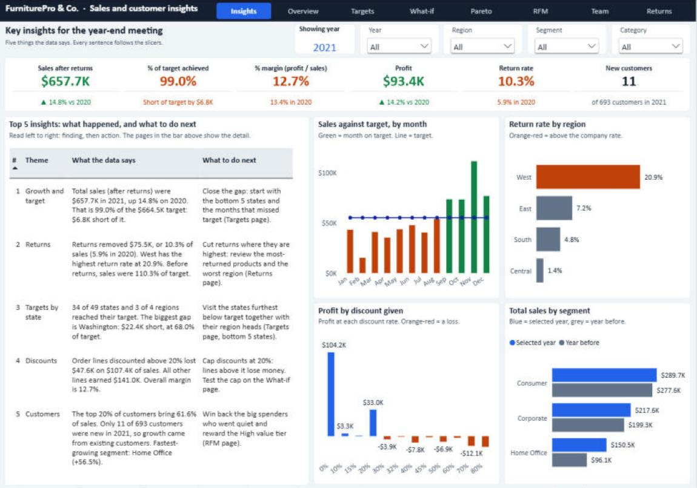</td>
<td align="center"><b>📊 Overview</b><br>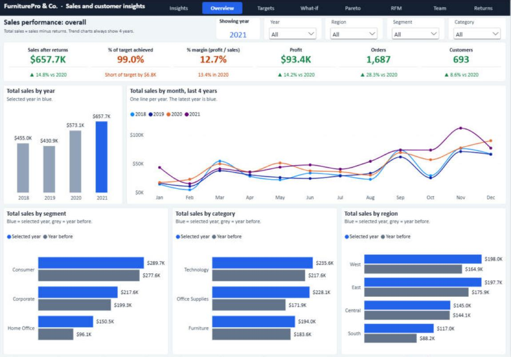</td>
</tr>
<tr>
<td align="center"><b>🎯 Targets</b><br>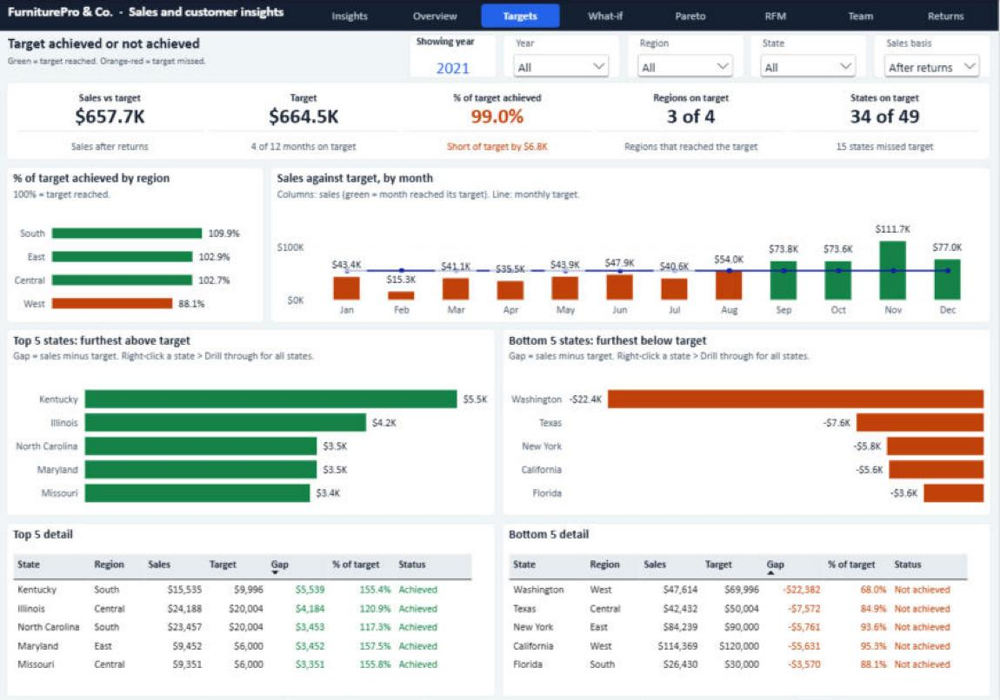</td>
<td align="center"><b>🧪 What-if</b><br>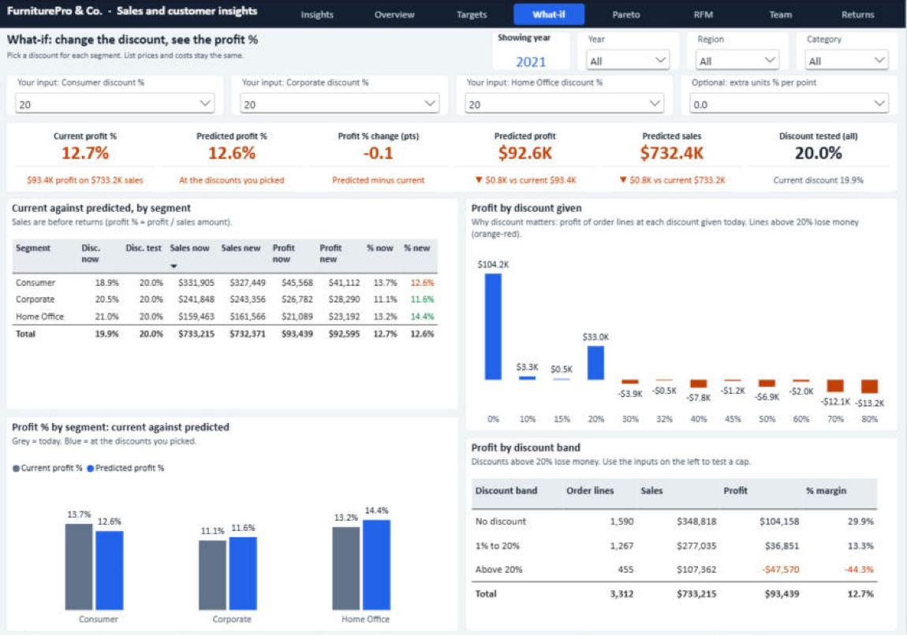</td>
</tr>
<tr>
<td align="center"><b>📈 Pareto</b><br>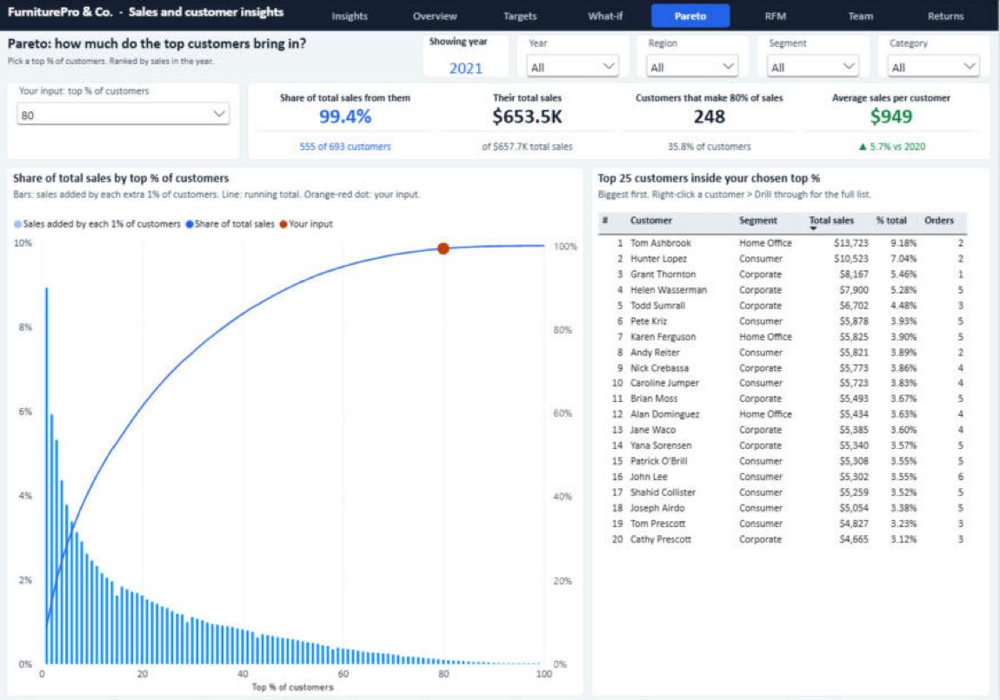</td>
<td align="center"><b>👥 RFM</b><br>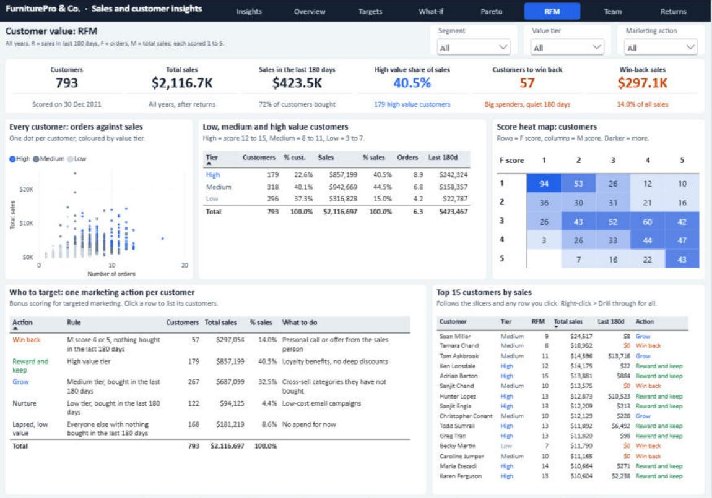</td>
</tr>
<tr>
<td align="center"><b>🧑‍🤝‍🧑 Team</b><br>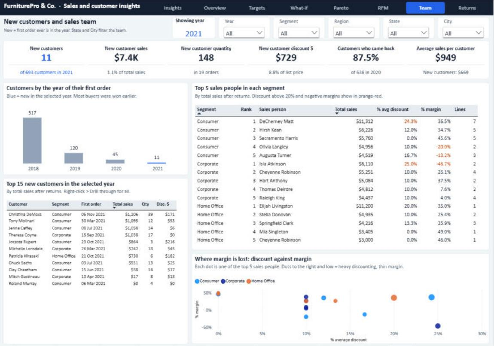</td>
<td align="center"><b>↩️ Returns</b><br>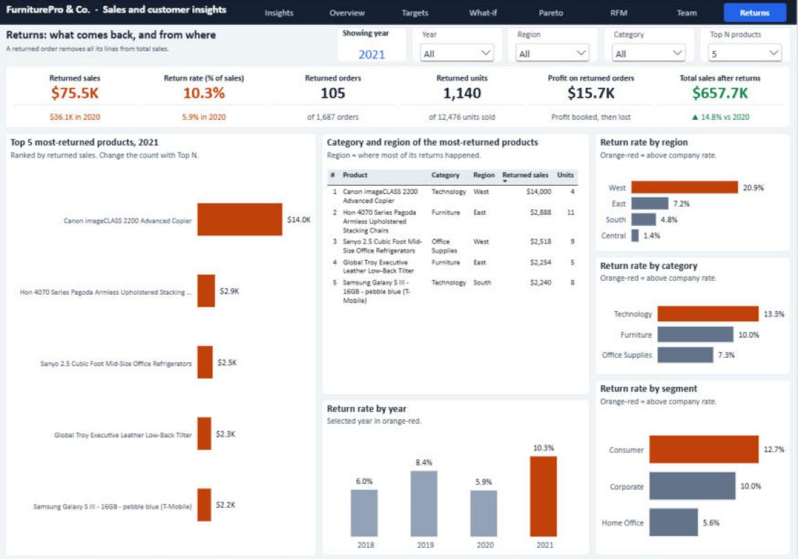</td>
</tr>
<tr>
<td align="center"><b>🔎 State detail (drill-through)</b><br>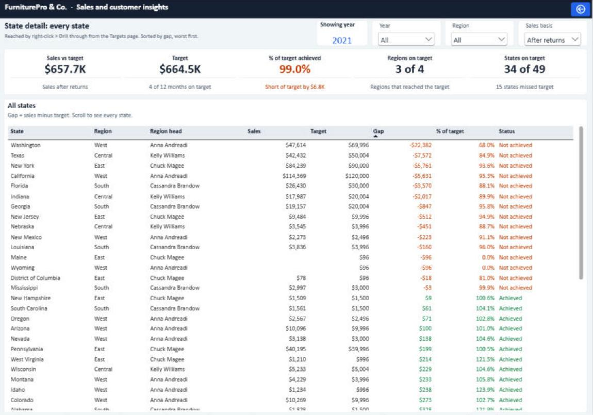</td>
<td align="center"><b>🔎 Customer detail (drill-through)</b><br>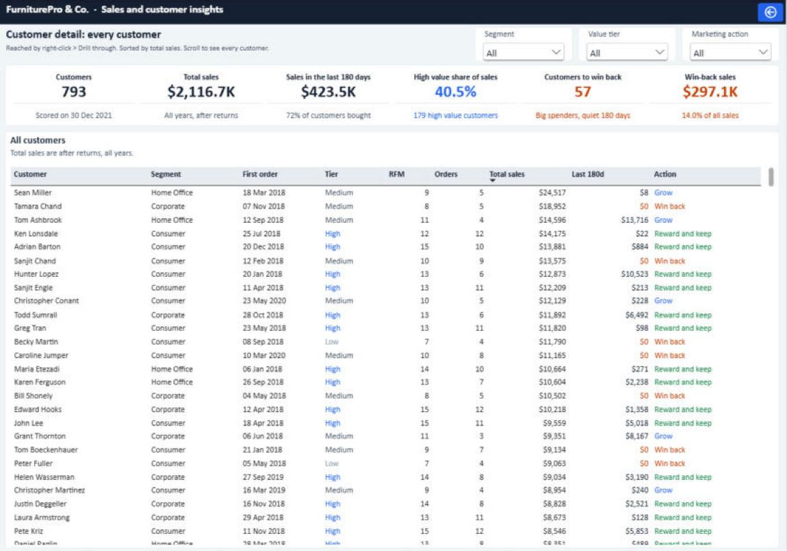</td>
</tr>
</table>

---

## 🧰 Tools & technology

| Layer | What I used |
|---|---|
| 🔌 **Data** | Excel workbook with 7 tables (Orders, Product, Customer, Returns, Sales Target, SalesPerson, Region Heads) |
| 🧮 **Modelling** | Power BI semantic model: 17 tables, relationships, **170 DAX measures** |
| 📊 **Visuals** | Power BI new Card visual with reference labels, slicers, drill-through, conditional formatting |
| 🐍 **Automation** | Python scripts that generate and validate the report files (`tools/`) |
| 🗂️ **Versioning** | PBIP / PBIR / TMDL text format, so the report works with Git |
| 🎨 **Design system** | Navy `#172033` · Blue `#2563EB` · Slate `#64748B` · Green `#16834A` · Terracotta `#C2410C` · Canvas `#F1F5F9` · Border `#E2E8F0`, Calibri throughout |

## 💪 Skills shown
- ✅ **Data modelling**: relationships, date and target logic, measure tables
- ✅ **Advanced DAX**: variance, RFM scoring, Pareto cumulative share, what-if discount simulation, dynamic card notes and colours
- ✅ **Dashboard storytelling**: one question per page, insights first, detail on drill-through
- ✅ **UI/UX for BI**: consistent grid, no clipped text, no needless scrollbars, accessible colours
- ✅ **Report automation and QA**: scripted build plus a schema check on every file
- ✅ **Business thinking**: from "what happened" to "what should we do"

---

## 🏗️ How it fits together
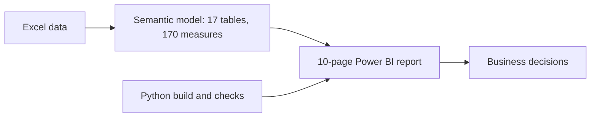

## 📁 Repository layout
```
📦 furniturepro-sales-insights
 ┣ 📂 powerbi   FurniturePro.pbip + Report and SemanticModel
 ┣ 📂 data      FurniturePro_Data.xlsx
 ┣ 📂 tools     Python scripts that build and check the report
 ┣ 📂 assets    Report page screenshots
 ┗ 📄 README.md
```

## 🚀 Open it yourself
1. Install **Power BI Desktop** and turn on the *Power BI Project (.pbip)* preview feature.
2. Open `powerbi/FurniturePro.pbip`.
3. If asked, point the data source to `data/FurniturePro_Data.xlsx`.

---

## 👤 Author
**Vikash Mishra** · BI & Analytics
[](https://github.com/vm8181)
